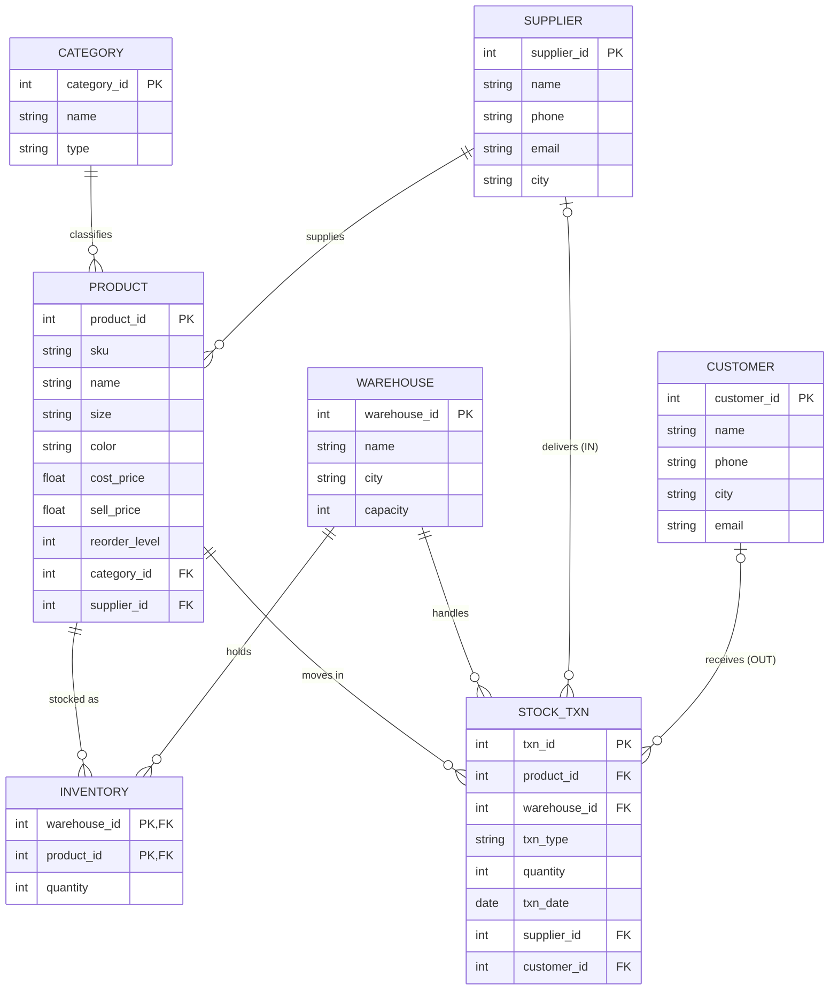

# StyleStock: Warehouse Management System for a Clothing & Footwear Brand
DBMS Micro Project

## 1. Problem Statement
**Title:** StyleStock, a database-driven warehouse management system for a clothing and footwear brand.

**Background:** Apparel and footwear brands stock thousands of SKUs, because one design is sold in many sizes and colours. Stock moves between suppliers, several warehouses and retail customers every day.

**Existing problem:** Many small brands track stock in spreadsheets or on paper. This leads to duplicate and inconsistent data, stock that does not match reality, overselling, missed reorders, and no quick view of stock value or supplier performance.

**Proposed solution:** A relational database that stores categories, products (SKU-level), suppliers, warehouses, customers, per-warehouse inventory and every stock movement. Constraints and a trigger keep inventory consistent: stock can never go negative, and each movement is linked to either a supplier (IN) or a customer (OUT). A web frontend lets staff add, update, delete and search products, record stock movements, and view reports.

## 2. ER Diagram

(Paste the block into https://mermaid.live to export it as an image for the report.)

| Relationship | Cardinality | Participation |
|---|---|---|
| Category classifies Product | 1 : N | Product total (every product has a category); Category partial |
| Supplier supplies Product | 1 : N | Product total; Supplier partial |
| Warehouse – Product (via Inventory) | M : N | Both partial |
| Product has Stock_Txn | 1 : N | Stock_Txn total; Product partial |
| Warehouse handles Stock_Txn | 1 : N | Stock_Txn total; Warehouse partial |
| Supplier delivers Stock_Txn (IN) | 1 : N | Optional for Stock_Txn (mandatory only when type = IN) |
| Customer receives Stock_Txn (OUT) | 1 : N | Optional for Stock_Txn (mandatory only when type = OUT) |

Weak/associative entities: **Inventory** resolves the Warehouse–Product M:N relationship, with composite key (warehouse_id, product_id).

## 3. Relational Model
| Table | Attributes (type) | PK | FK | Candidate/Alternate keys | Constraints |
|---|---|---|---|---|---|
| category | category_id INT, name TEXT, type TEXT | category_id | – | name | name UNIQUE NOT NULL; type IN ('Clothing','Footwear') |
| supplier | supplier_id INT, name TEXT, phone TEXT, email TEXT, city TEXT | supplier_id | – | phone, email | phone UNIQUE NOT NULL; email UNIQUE |
| warehouse | warehouse_id INT, name TEXT, city TEXT, capacity INT | warehouse_id | – | name | capacity > 0 |
| customer | customer_id INT, name TEXT, phone TEXT, city TEXT, email TEXT | customer_id | – | phone | phone UNIQUE NOT NULL |
| product | product_id INT, sku TEXT, name TEXT, size TEXT, color TEXT, cost_price REAL, sell_price REAL, reorder_level INT, category_id INT, supplier_id INT | product_id | category_id → category, supplier_id → supplier | sku | sku UNIQUE; cost_price ≥ 0; sell_price ≥ cost_price; reorder_level ≥ 0, default 10 |
| inventory | warehouse_id INT, product_id INT, quantity INT | (warehouse_id, product_id) | warehouse_id → warehouse, product_id → product | – | quantity ≥ 0 |
| stock_txn | txn_id INT, product_id INT, warehouse_id INT, txn_type TEXT, quantity INT, txn_date DATE, supplier_id INT, customer_id INT | txn_id | product_id, warehouse_id, supplier_id, customer_id | – | txn_type IN ('IN','OUT'); quantity > 0; IN requires supplier only, OUT requires customer only |

All tables are in 3NF: non-key attributes depend only on the key (for example, supplier details are stored once in `supplier`, not repeated in each product or transaction).

## 4. Implementation Files
| File | Contents |
|---|---|
| `schema.sql` | CREATE TABLE with constraints, ALTER TABLE, trigger, INSERT sample data (6 categories, 5 suppliers, 3 warehouses, 6 customers, 10 products, 15 transactions, 10 inventory rows) |
| `queries.sql` | UPDATE, DELETE, SELECT, WHERE, ORDER BY, GROUP BY, aggregates, HAVING, joins, subqueries |
| `app.py` | Flask + SQLite frontend (Dashboard, Add, Update, Delete, Search, 2 reports) |

DBMS used: SQLite. `sqlite3 warehouse.db < schema.sql` is the CREATE DATABASE step; `app.py` also does it automatically on first run.

## 5. How to Run
```
pip install flask
python app.py        # open http://127.0.0.1:5000
sqlite3 warehouse.db < queries.sql   # optional: run the demo queries
```
Delete `warehouse.db` to reset the data.

## 6. Requirement Checklist
| Brief requirement | Where |
|---|---|
| Home/Dashboard | `/` totals, low-stock alerts, recent transactions |
| Add record | `/products/new`, `/stock` |
| Update record | `/products/<id>/edit` |
| Delete record | Delete button on `/products` (blocked by FK if the product has transactions) |
| Search record | search box on `/products` |
| Reports | `/reports`: stock value by category; supplier-wise purchase summary |
